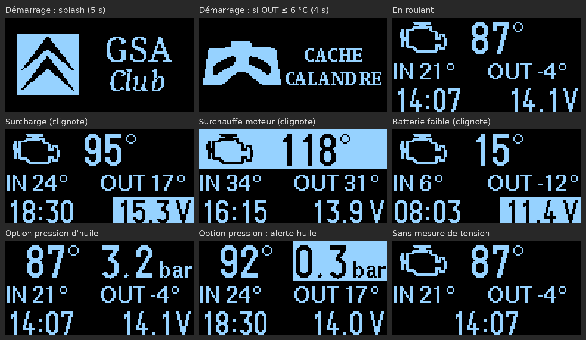

# Citroën GSA Temperature monitoring system

### Simple Temperature Sensor System for Citroën GSA Based on DS18B20

The Citroën GSA is rare nowadays, but enthusiasts like me still cherish it! 🚗  

  

That's why I developed a small temperature monitoring system to ensure a safe and comfortable driving experience.  

The system includes sensors placed outdoors, indoors, and on the engine to track temperatures while driving.

A must-have if this classic is your daily ride!

---

**BOM:**
   - Arduino Uno or Nano (ATmega328P)
   - DS18B20 temperature sensors (pin D4, 4.7 kΩ pull-up)
   - DS3231 real-time clock module
   - SH1106 OLED display (128x64px)
   - 2 push buttons wired to GND: hours on D2, minutes on D3
   - Optional: battery voltage on A0 (33 kΩ / 10 kΩ divider), oil pressure sender (0.5-4.5 V) on A1

**Libraries:** OneWire, DallasTemperature, U8g2, Time, DS1307RTC (works with the DS3231), Timezone.

**Configuration:**
   - Assign each sensor to its correct location (outdoor, indoor, engine): the sensor addresses are printed on the serial monitor (115200 baud) at startup.
   - Set the time once by sending `T` followed by the current Unix time in UTC (output of `date +%s`) on the serial monitor. Daylight saving time is handled automatically; use the buttons for small adjustments.
   - Enable or disable the optional measurements with `OPTION_TENSION` and `OPTION_PRESSION_HUILE`.

Version 1.0 (DS1307, no buttons) is available in the [`1.0`](https://github.com/stoneset/GSA-Temperature/tree/1.0) branch.

---

<table>
  <tr>
    <td></td>
    <td></td>
  </tr>
</table>